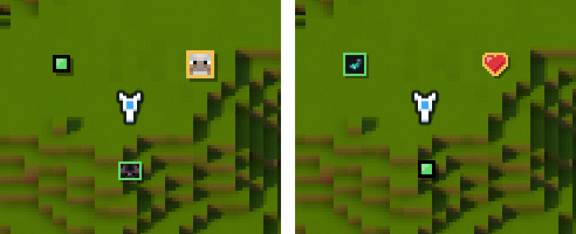

# Custom radar icons

Diorama's radar shows each mob as its face. Vanilla mobs have hand-drawn faces. For every other mob, modded ones included, Diorama tries to read a face off the mob's 3D model, and if that doesn't work the mob shows up as a coloured dot.

You can pick the icon yourself: your own picture, an item, or a dot. It takes a resource pack with two small files per mob, and no code.



On the left, the minimap without any pack: a wolf's face at the top right, a glow squid as a dot, and a bat's face below the player. On the right, the same spot with the [example pack](#try-the-example-pack) turned on.

Diorama reads the icon files Xaero's Minimap uses, so any icon you make here works in Xaero's Minimap too, and icons that mods and packs already ship for Xaero's show up in Diorama without any work. You don't need Xaero's Minimap installed.

## Try the example pack

1. Download [diorama-example-radar-icons.zip](radar-icons/diorama-example-radar-icons.zip).
2. Put the zip in your `.minecraft/resourcepacks` folder. In the game, **Options > Resource Packs > Open Pack Folder** opens it for you.
3. Turn the pack on in **Options > Resource Packs**.

Find a wolf and it has a red heart on the radar. Glow squids show a glow ink sac, and bats become dots. The rest of this page builds that pack from scratch, so you can change it for the mobs you care about.

## Make your own

### 1. Find the mob's ID

Every mob has an ID like `minecraft:wolf` or `alexsmobs:grizzly_bear`. The part before the colon is the mod (the namespace), the part after it is the mob.

To find it, open a world with cheats on and type `/summon ` in chat, then the start of the mob's name. The game suggests the full ID.

### 2. Set up the pack folder

Make a folder in `.minecraft/resourcepacks`, say `my-radar-icons`, and give it this layout:

```
my-radar-icons/
├── pack.mcmeta
└── assets/
    └── xaerominimap/
        └── entity/
            └── icon/
                ├── definition/
                │   └── minecraft/
                │       └── wolf.json
                └── sprite/
                    └── my_icons/
                        └── heart.png
```

`pack.mcmeta` tells Minecraft the folder is a resource pack. This one works on every version Diorama supports:

```json
{
  "pack": {
    "description": "My radar icons",
    "pack_format": 34,
    "supported_formats": [34, 1000],
    "min_format": 34,
    "max_format": 1000
  }
}
```

### 3. Draw the icon

Draw a small PNG with a transparent background and save it under `sprite/`. You can make subfolders there to keep things tidy, like `my_icons/` above.

A mob's face on the radar is 8 by 8 pixels, so draw your icon about that size, 8 to 12 pixels across. Diorama trims the empty space around it. Bigger images get shrunk to a half, a third and so on, so they stay sharp but lose detail.

The example pack's heart is 9 by 8:


### 4. Point the mob at it

The definition file goes in `definition/<namespace>/<mob>.json`. For `minecraft:wolf` that's `definition/minecraft/wolf.json`; for `alexsmobs:grizzly_bear` it would be `definition/alexsmobs/grizzly_bear.json`.

```json
{
  "variants": {
    "default": "outlined_sprite:my_icons/heart.png"
  }
}
```

The path after `outlined_sprite:` starts inside the `sprite/` folder.

### 5. Load it

Turn the pack on in **Options > Resource Packs**. After you change a file, press `F3` + `T` to reload packs; you don't need to restart the game.

## What an icon can be

| In the file | On the radar |
| --- | --- |
| `outlined_sprite:<path>` | Your image with a one-pixel outline. The outline is red, yellow or green for hostile, neutral or passive mobs, or black if you turned off **Colour by mob type** in the radar settings. |
| `normal_sprite:<path>` | Your image with a drop shadow and no outline. |
| `item:<item id>` | That item, for example `item:minecraft:glow_ink_sac`. Handy when you don't want to draw anything. |
| `dot` | A coloured dot. Good for mobs that clutter the map, like bats. |
| `model` | Diorama's own face for the mob, or a dot if it has none. |

`sprite:<path>` also works. It's Xaero's older form and draws the image upside down.

Your icon replaces the face in the default **Pixel heads** style. In the **Framed** style it sits inside the coloured frame. In the **Dots** style every mob is a dot, whatever its file says.

## Different icons for different looks

Some mobs come in several looks, like a mod's frog in three colours. Each look uses a different texture, and you can give each texture its own icon. Use the texture's ID as the key, and keep `default` for any look you didn't list:

```json
{
  "variants": {
    "examplemod:textures/entity/frog/green.png": "outlined_sprite:my_icons/green_frog.png",
    "examplemod:textures/entity/frog/blue.png": "outlined_sprite:my_icons/blue_frog.png",
    "default": "outlined_sprite:my_icons/frog.png"
  }
}
```

The texture ID is the texture's path inside the mod's jar: `assets/examplemod/textures/entity/frog/green.png` becomes `examplemod:textures/entity/frog/green.png`.

Xaero's Minimap builds longer IDs for a few vanilla mobs (`...iron_golem.png%MEDIUM`) and lets mods build their own. Diorama can't match those, so those mobs get the `default` icon.

## For mod authors

Ship the same files in your mod, under `src/main/resources/assets/xaerominimap/entity/icon/`. Players with Diorama or Xaero's Minimap then see your icons with no pack to install, and a resource pack can still replace them.

## If an icon doesn't show

- Check the file names and folders against the layout above. The definition file has to be named exactly like the mob, `grizzly_bear.json` for `alexsmobs:grizzly_bear`.
- Make sure the pack is turned on, and above any other pack that has an icon for the same mob. The top pack wins.
- Look in `.minecraft/logs/latest.log`. Diorama writes `Radar icons from Xaero's Minimap icon files: N loaded` when it finds your files, and a line starting `Radar icon file` for each file it couldn't read, with the reason, like a missing image or a typo in the JSON.
- Check the radar style. In the **Dots** style every mob is a dot.
